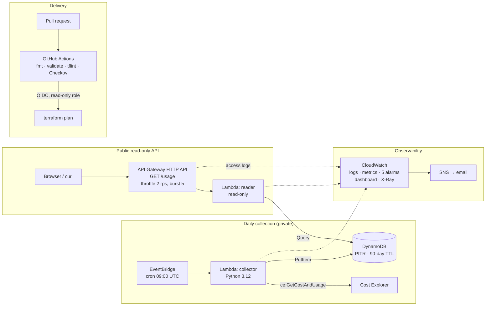
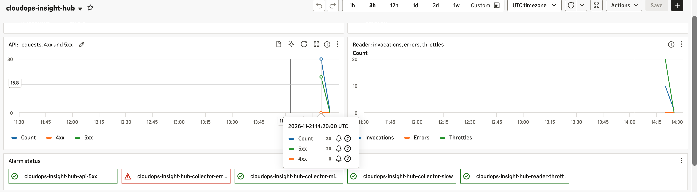
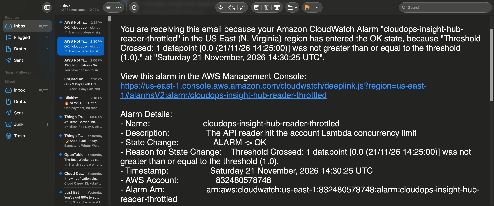
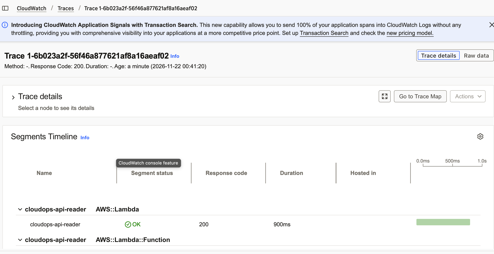
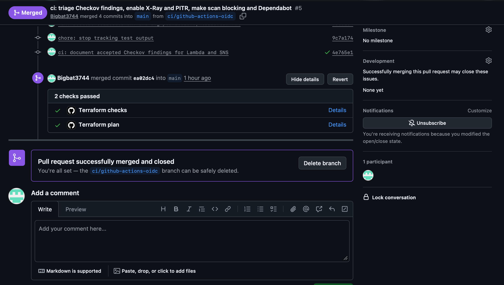

# CloudOps Insight Hub

Serverless AWS cost monitoring: a daily job collects spend by service from Cost Explorer, stores snapshots in DynamoDB, and serves them through a throttled, read-only API to a Chart.js dashboard. All infrastructure is defined in Terraform, checked in CI, and monitored with CloudWatch alarms.

[](https://github.com/Bigbat3744/cloudops-insight-hub/actions/workflows/terraform-ci.yml)


> **Scope:** a personal project running in my own AWS account (single `dev` environment). It is not a production system. Every result below was produced and verified in that account.

---

## What this project demonstrates

| Skill | Where to see it |
|---|---|
| Infrastructure as Code | Terraform split by concern, S3 remote state with native locking, reproducible from a fresh clone ([PR #1](../../pull/1)) |
| Least-privilege IAM | Separate collector and reader roles scoped to exact ARNs, verified with `iam simulate-principal-policy` ([PR #2](../../pull/2)) |
| API security | Read-only API, input validation, safe error responses, stage throttling ([PR #2](../../pull/2)) |
| Monitoring and alerting | 5 CloudWatch alarms → SNS email, dashboard, access logs, X-Ray tracing ([PR #3](../../pull/3), [PR #5](../../pull/5)) |
| CI/CD without stored keys | GitHub Actions with OIDC: fmt, validate, tflint, Checkov and `terraform plan` on every PR ([PR #4](../../pull/4), [PR #5](../../pull/5)) |
| Security triage | Checkov findings fixed or accepted with written justification ([PR #5](../../pull/5)) |
| Troubleshooting | Load-test 503s diagnosed from metrics; incidents documented below |

---

## Architecture



**Design decisions**

- **Separation of duties.** The collector is the only component that calls Cost Explorer or writes data, and it can only be triggered by EventBridge. The public API uses a separate reader function that can only query DynamoDB. If the API were abused, the worst outcome is reading cost snapshots: it cannot write data or run up Cost Explorer charges.
- **HTTP API rather than REST API.** It is cheaper (about $1.00 vs $3.50 per million requests) and simpler; this project does not need usage plans, API keys or request validators.
- **Serve from DynamoDB, not live.** Cost Explorer charges about $0.01 per request. Serving stored snapshots keeps Cost Explorer calls fixed at one per day whatever the API traffic.
- **CI plans; I apply.** The CI role is read-only. An apply role would need permission to create IAM roles, which is effectively privilege escalation, so for a one-person project I review the CI plan and apply locally.

---

## Components

| Resource | Purpose | File |
|---|---|---|
| Lambda `cloudops-aws-collector` | Fetches 7-day cost by service; writes summary and per-service items | `terraform/aws/lambda.tf`, `backend/collectors/lambda_function.py` |
| Lambda `cloudops-api-reader` | Serves the latest (or a dated) snapshot; validates input | `terraform/aws/lambda.tf`, `backend/api/lambda_function.py` |
| EventBridge rule | Runs the collector daily at 09:00 UTC | `terraform/aws/schedule.tf` |
| DynamoDB `cloudops-usage` | Single-table design (`pk = COST#date`, `sk = SUMMARY` / `SERVICE#name`), on-demand, 90-day TTL, point-in-time recovery | `terraform/aws/dynamodb.tf` |
| API Gateway HTTP API | `GET /usage`, stage throttling, JSON access logs | `terraform/aws/api.tf` |
| CloudWatch + SNS | Alarms, dashboard, email alerts | `terraform/aws/monitoring.tf` |
| IAM roles and policies | One role per function, plus the CI plan role | `terraform/aws/iam.tf`, `terraform/aws/github-oidc.tf` |
| GitHub Actions | PR checks and plan | `.github/workflows/terraform-ci.yml` |

---

## Security

### IAM: what each role can do

| Role | Allowed | Notably **not** allowed |
|---|---|---|
| Collector | `ce:GetCostAndUsage`; `dynamodb:PutItem` on this table; write its own log group; X-Ray | Read the table, invoke anything, any other table or log group |
| Reader | `dynamodb:Query` on this table; write its own log group; X-Ray | Write data, call Cost Explorer |
| CI plan (OIDC) | Read the configuration of this stack's resources; read the state file; write only the lock file | Create, update or delete anything; read table items (no `GetItem` / `Scan`); read log contents |

The CI role can only be assumed by a pull request in this repository (`sub = repo:Bigbat3744/cloudops-insight-hub:pull_request`). There are no AWS access keys stored in GitHub.

**Verified with `aws iam simulate-principal-policy`:**

```
Reader role                          CI plan role
dynamodb:Query       allowed         lambda:GetFunction          allowed
dynamodb:PutItem     implicitDeny    lambda:UpdateFunctionCode   implicitDeny
ce:GetCostAndUsage   implicitDeny    iam:CreateRole              implicitDeny
                                     dynamodb:Scan               implicitDeny
                                     s3:DeleteBucket             implicitDeny
```

### API protections

- Input validation: `date` must be `YYYY-MM-DD` (otherwise `400`).
- Errors return a generic message and a `request_id`; details go to CloudWatch Logs only.
- Stage throttling (2 req/s, burst 5). API Gateway throttling is best-effort at low limits; the account's Lambda concurrency limit acts as a hard backstop (see the load test below).

### Security scanning (Checkov) and accepted risks

Checkov runs on every PR and blocks merges on any new, unexplained finding. Two findings were fixed (X-Ray tracing, DynamoDB point-in-time recovery). The rest are accepted deliberately, with reasons recorded in [`terraform/aws/.checkov.yaml`](terraform/aws/.checkov.yaml) and inline `#checkov:skip` comments:

| Check | Decision |
|---|---|
| Log retention ≥ 1 year | 14 days on purpose: access logs contain IP addresses (UK GDPR data minimisation), and short retention keeps cost near zero |
| KMS for logs / DynamoDB / Lambda env vars | Already encrypted at rest with AWS-managed or AWS-owned keys; the data is non-sensitive and a customer-managed key isn't justified for a dev sandbox |
| SNS encryption | CloudWatch alarms can't publish to a topic encrypted with the AWS-managed SNS key; alert messages contain no sensitive data |
| Reserved concurrency | Not possible: the account limit is 10 and AWS requires 10 to stay unreserved |
| Dead-letter queue | Collector input is constant and failures raise an alarm; the reader is synchronous |
| Lambda in a VPC | The functions only call public AWS APIs; a VPC would need a NAT gateway or endpoints with no benefit |
| Code signing | Single author; code reaches AWS only through Terraform from reviewed `main` |
| `*` resource in the CI role | Read-only actions such as `DescribeAlarms` require `*`; no write actions are granted |
| No API authentication | Public, read-only by design; see Limitations |

---

## Monitoring

| Alarm | Fires when | Why |
|---|---|---|
| `collector-errors` | ≥ 1 collector error in 5 min | The daily collection failed |
| `collector-missed-run` | < 1 invocation in 24 h (missing data = breaching) | Detects the job **not running at all** |
| `collector-slow` | Max duration > 20 s (timeout 30 s) | Early warning before timeouts |
| `api-5xx` | ≥ 5 server errors in 5 min | Users are getting errors |
| `reader-throttled` | ≥ 1 Lambda throttle in 5 min | The account concurrency limit was reached |

Every alarm emails on both ALARM and OK through SNS. There is also a CloudWatch dashboard (collector, reader, API and alarm status), JSON API access logs and X-Ray traces.

<!-- Screenshots: add the files to docs/images/ and they will render here -->




---

## CI/CD

On every pull request into `main`:

1. **Terraform checks:** `terraform fmt -check`, `terraform validate`, `tflint`, and a blocking Checkov scan.
2. **Terraform plan:** signs in to AWS with OIDC (temporary credentials, no stored keys) and runs `terraform plan` against the real state. The account ID is held in a secret, so it is masked in public logs.

Both checks are required before merging. Dependabot opens weekly PRs to keep the GitHub Actions versions current.



---

## Cost

| Item | Monthly cost |
|---|---|
| Cost Explorer API (1 call per day) | ~ $0.30 |
| Lambda, API Gateway, DynamoDB, CloudWatch (5 alarms, 1 dashboard), SNS email, X-Ray | Within the AWS free tier at this usage |
| DynamoDB point-in-time recovery | Billed per GB; the table is a few KB, so < $0.01 |

The dashboard itself shows that Cost Explorer API calls are the largest line item on this account.

---

## Deploy it yourself

**Prerequisites:** Terraform ≥ 1.10, AWS CLI signed in with an IAM user or SSO role (not root), and Cost Explorer enabled on the account.

```bash
# 1. One-off: create the remote state bucket (versioned, private)
ACCOUNT_ID=$(aws sts get-caller-identity --query Account --output text)
BUCKET="cloudops-tfstate-$ACCOUNT_ID"
aws s3api create-bucket --bucket "$BUCKET" --region eu-west-2 \
  --create-bucket-configuration LocationConstraint=eu-west-2
aws s3api put-bucket-versioning --bucket "$BUCKET" --versioning-configuration Status=Enabled
aws s3api put-public-access-block --bucket "$BUCKET" --public-access-block-configuration \
  BlockPublicAcls=true,IgnorePublicAcls=true,BlockPublicPolicy=true,RestrictPublicBuckets=true

# 2. Configure (both files are git-ignored)
cd terraform/aws
cp backend.hcl.example backend.hcl              # set your bucket name
cp terraform.tfvars.example terraform.tfvars    # set alert_email

# 3. Deploy
terraform init -backend-config=backend.hcl
terraform plan -out=tfplan
terraform apply tfplan
```

Then confirm the SNS subscription email that AWS sends you, or no alerts will arrive.

For CI, add the repository secrets `AWS_ACCOUNT_ID` and `ALERT_EMAIL`, and update `github_repository` in `github-oidc.tf` if you fork the repo.

---

## API

### `GET /usage`

| Parameter | Required | Description |
|---|---|---|
| `date` | No | `YYYY-MM-DD`. Omit it to get the latest snapshot from the last 7 days |

| Status | Meaning |
|---|---|
| `200` | Snapshot returned |
| `400` | Invalid `date` |
| `404` | No snapshot for that date |
| `429` | Throttled by API Gateway |
| `500` | Server error (generic message and `request_id`) |
| `503` | Lambda concurrency limit reached |

```bash
curl "$(terraform output -raw api_url)"
curl "$(terraform output -raw api_url)?date=2026-11-20"
```

Example response (real values from my account; `by_service` trimmed):

```json
{
  "message": "Cost snapshot retrieved",
  "data": {
    "date": "2026-11-20",
    "total_cost": 0.31,
    "currency": "USD",
    "period_days": 7,
    "service_count": 11,
    "by_service": { "AWS Cost Explorer": 0.09, "Amazon Elastic Compute Cloud - Compute": 0.09 },
    "collected_at": "2026-11-20T19:27:30.349162"
  }
}
```

---

## Testing evidence

| Test | Result |
|---|---|
| Reproducibility | CI runs `terraform plan` from a fresh checkout on every PR → "No changes" |
| Scheduled collection | CloudWatch Logs show a run every day at 09:00 UTC, with no gap across the migration to the new rule |
| API responses | 200 / 400 / 404 returned as designed |
| Least privilege | `simulate-principal-policy` results above |
| Sustained load (~10 req/s for 6 s) | 52 × 200, 8 × 429: gateway throttling active |
| Instant burst (30 concurrent) | 10 × 200, 20 × 503: account Lambda concurrency limit (10), confirmed by the reader's `Throttles` metric |
| Alerting | Forced collector failure and burst test → alarm emails, then OK emails on recovery |
| CI | Both jobs green; plan "No changes"; scan blocking |

---

## Incidents and lessons learned

1. **`ResourceAlreadyExistsException` on first apply.** Deleting a Lambda leaves its log group behind. I imported it with `terraform import` instead of deleting it, which kept its history and applied a retention policy.
2. **Verify before "fixing".** I suspected the old schedule rule (cron plus an unused event pattern) wasn't firing. The logs showed it was. I still simplified the rule, but the evidence changed the story.
3. **503s instead of 429s in a load test.** API Gateway throttling is best-effort, and a single instant burst hit the account's 10-concurrent-Lambda limit instead. I diagnosed this from the stage settings, the account limit and the Lambda `Throttles` metric, then ran a sustained-load test, which confirmed the gateway throttle.
4. **Errors that monitoring couldn't see.** The collector caught every exception and returned a 500 body, and a failed DynamoDB write still reported success. To Lambda, failed runs looked successful. I changed it to log and re-raise, so failures reach metrics, alarms and EventBridge retries.
5. **A valid change that would have broken production.** A manual edit removed the collector's `TABLE_NAME` variable and its log permission. It passed `fmt`, `validate` and `tflint`, and was caught by reading the diff. Automated checks catch syntax, not intent, so I always read the plan detail before applying.

---

## Limitations and next steps

- **No authentication on the API.** Snapshots are readable by anyone with the URL. Next step: a Cognito JWT authoriser.
- **Shared concurrency.** The API and collector share the account's 10-function limit. Next step: a Service Quotas increase, then reserved concurrency for the collector.
- **Dashboard runs locally.** `frontend/dashboard.html` is opened from disk and isn't yet hosted through Terraform. Next step: S3 and CloudFront with Origin Access Control.
- **Single environment.** Next step: separate `dev` and `prod` workspaces or accounts.
- **`terraform/azure/`** is an early Azure Functions prototype and isn't part of the deployed system.

---

## Repository structure

```
.
├── .github/
│   ├── workflows/terraform-ci.yml   # PR checks + OIDC plan
│   └── dependabot.yml               # weekly GitHub Actions updates
├── backend/
│   ├── collectors/lambda_function.py   # scheduled collector
│   └── api/lambda_function.py          # read-only API
├── frontend/dashboard.html          # Chart.js dashboard
├── docs/images/                     # screenshots used in this README
└── terraform/
    ├── aws/                         # the deployed stack
    │   ├── versions.tf  variables.tf  outputs.tf
    │   ├── dynamodb.tf  lambda.tf  iam.tf  api.tf  schedule.tf
    │   ├── monitoring.tf  github-oidc.tf
    │   ├── .checkov.yaml  .tflint.hcl
    │   └── backend.hcl.example  terraform.tfvars.example
    └── azure/                       # prototype, not deployed
```
